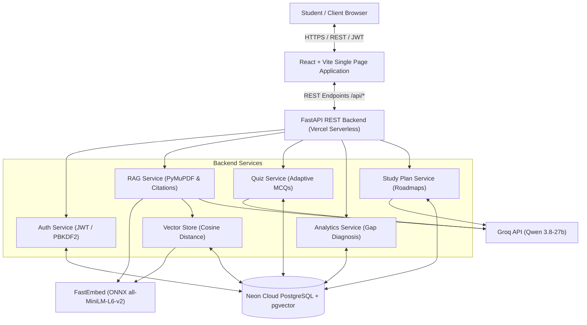
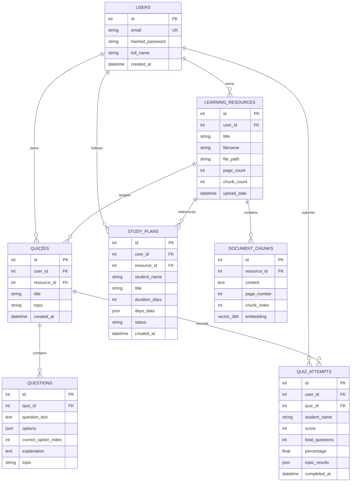

# LearnLens AI - Current System Architecture

## 1. System Overview
LearnLens AI is an adaptive, multi-tenant AI tutoring and study planning platform designed to transform static study materials (PDF lecture slides, textbooks, course notes) into an interactive, grounded learning ecosystem.

Unlike generic conversational RAG systems, LearnLens AI enforces a **closed-loop pedagogical cycle**:
1. **Document Ingestion & Grounding**: Parses PDFs and indexes content at the page level.
2. **Attributed RAG Querying**: Retrieves source-grounded excerpts with exact page citations (`[Page X]`).
3. **Adaptive Quiz Generation**: Formulates concept-tagged multiple-choice quizzes with detailed rationales.
4. **Knowledge Gap Analytics**: Continuously tracks mastery percentages per concept, automatically detecting weak areas (< 60% accuracy).
5. **Personalized Study Planner**: Synthesizes diagnostic gap analysis into actionable, multi-day study roadmaps with task checklists and direct citations.

---

## 2. High-Level Architecture Diagram

---

## 3. Technology Stack & Key Decisions

| Layer | Component | Choice | Rationale |
| :--- | :--- | :--- | :--- |
| **Frontend** | Framework | React 18 + Vite | Fast HMR, minimal bundle overhead, component-driven UI. |
| **Frontend UI** | Styling | TailwindCSS + Lucide Icons | Responsive modern design with dark-mode aesthetic. |
| **Backend** | Framework | FastAPI (Python 3.12) | Asynchronous request handling, Pydantic validation, OpenAPI documentation. |
| **Database** | RDBMS & Vector Store | PostgreSQL 16 + `pgvector` (Neon) | Single ACID operational database for relational multi-tenant entities and high-dimensional vector search. |
| **Connection Pooling** | Pool Manager | SQLAlchemy `NullPool` | Optimized for serverless execution where connections must not remain open across frozen lambda instances. |
| **Embedding Engine** | Vector Embedder | FastEmbed (`all-MiniLM-L6-v2` ONNX) | Lightweight (~30MB runtime), zero PyTorch/CUDA dependencies, sub-50ms embedding generation. |
| **LLM Provider** | Inference API | Groq Cloud (`qwen/qwen3.8-27b`) | High token throughput (>300 tokens/sec), low time-to-first-token, accurate structured JSON outputs. |
| **Document Processing**| PDF Parser | PyMuPDF (`fitz`) | High-speed text extraction preserving page boundaries and block geometry. |

---

## 4. Multi-Tenant Data Model

Every user-facing data record is scoped to a specific `user_id`.

---

## 5. API Endpoints Catalog

### Authentication
- `POST /api/auth/signup`: Register new student account (PBKDF2-hashed password).
- `POST /api/auth/login`: Authenticate and receive JWT bearer token.
- `POST /api/auth/demo-login`: 1-click instant login as pre-seeded demo user (`demo@learnlens.ai`).
- `GET /api/auth/me`: Fetch authenticated student profile.
- `POST /api/auth/forgot-password`: Password reset request.
- `POST /api/auth/reset-password`: Set new password.

### Documents & Ingestion
- `POST /api/upload`: Upload PDF notes, extract pages, chunk text, generate FastEmbed embeddings, and insert into pgvector.
- `GET /api/documents`: List documents owned by the authenticated student.
- `DELETE /api/documents/{id}`: Delete a document and cascade remove all chunks and vectors.

### Grounded RAG Assistant
- `POST /api/ask`: Execute similarity search against document chunks in `pgvector`, inject context into Groq prompt, and return answer with page citations.

### Quiz Engine & Evaluation
- `POST /api/quizzes/generate`: Formulate adaptive multiple-choice quiz from document chunks.
- `GET /api/quizzes`: List user-owned quizzes.
- `GET /api/quizzes/{id}`: Retrieve quiz with questions and choices.
- `POST /api/quizzes/{id}/submit`: Grade quiz answers, record attempt, and return question explanations.

### Analytics & Knowledge Gaps
- `GET /api/analytics`: Aggregate attempts, compute overall mastery, and isolate topics below 60% threshold.

### Dynamic Study Planner
- `POST /api/study-plans/generate`: Synthesize weak topics into a multi-day study plan.
- `GET /api/study-plans`: Retrieve active study plans.
- `PATCH /api/study-plans/{plan_id}/tasks/{task_id}`: Toggle task completion status.
