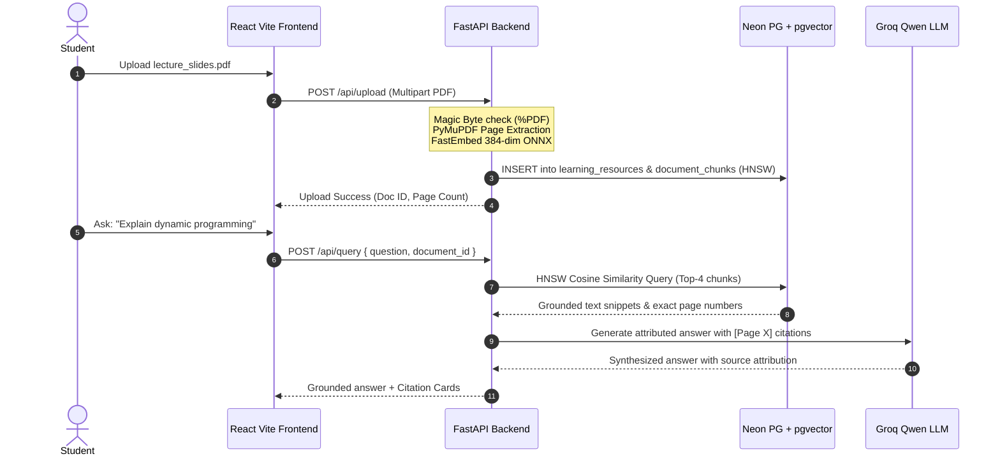

# LearnLens AI - System Design & Viva Cheatsheet

## Quick-Fire Technical Specifications

| Parameter | Specification | Notes / Rationale |
| :--- | :--- | :--- |
| **Backend Framework** | FastAPI (Python 3.12) | Asynchronous ASGI, Pydantic type safety, auto OpenAPI docs. |
| **Database** | Neon Cloud PostgreSQL 16 | Serverless auto-scaling compute, branching capability. |
| **Vector Extension** | `pgvector` with HNSW | Cosine distance metric (`vector_cosine_ops`), sub-linear lookup. |
| **Embedding Model** | `all-MiniLM-L6-v2` | 384 dimensions, normalized unit vectors, ONNX execution. |
| **Inference LLM** | Groq (`qwen/qwen3.8-27b`) | > 300 tokens/sec throughput, structured JSON mode. |
| **PDF Extraction** | PyMuPDF (`fitz`) | Retains exact physical page numbers (`page_number`). |
| **Chunking Parameters** | 512 characters, 50 overlap | Sliding window with paragraph/sentence boundary preference. |
| **Authentication** | JWT Bearer (HS256) | Salted bcrypt passwords (12 rounds), 24h access expiry, 15m reset. |
| **Cognitive Model** | 4-Parameter BKT | Prior (0.2), Transition (0.15), Guess (0.25), Slip (0.10). |

---

## Architectural Comparison Matrix

### 1. Vector Search: Flat vs IVFFlat vs HNSW
- **Flat (Sequential Scan)**: Exact $O(N)$ calculation. 100% recall, but scales poorly beyond $10^4$ vectors.
- **IVFFlat (Inverted File Flat)**: Clusters vectors into lists with centroids. Faster than flat, but requires pre-training and re-indexing when data changes.
- **HNSW (Hierarchical Navigable Small World - Selected)**: Multi-layer graph traversal. Provides $O(\log N)$ search time with > 98% recall without requiring periodic retraining. Ideal for continuous document uploads.

### 2. Chunking: Fixed-Character vs Structural vs Semantic
- **Fixed-Character**: Slices strictly at 512 characters. Can sever sentences in half and fragment context.
- **Sliding-Window with Natural Breaks (Implemented)**: 512 characters with 50-character overlap, prioritizing sentence terminals (`. `, `?\n`, `!\n`, `\n\n`).
- **Structural Paragraph Chunking (Implemented in v2)**: Respects logical paragraph divisions, falling back to sliding-window only for oversized passages.

---

## Data Flow: End-to-End Walkthrough

---

## Common Viva Gotchas & How to Answer

### Q1: "What happens if two students upload documents with the same filename?"
> "Filenames are sanitized using `re.sub(r'[^a-zA-Z0-9_.-]', '_', filename)` and saved into tenant-isolated storage directories `data/uploads/user_{id}/`. Furthermore, all database queries index on integer primary keys (`id`) bound to `user_id`. Identical filenames across different users never collide."

### Q2: "Why do you use Cosine Distance rather than Euclidean (L2) or Inner Product?"
> "SentenceTransformers and FastEmbed models output **normalized unit vectors** ($\|v\| = 1$). For normalized vectors, Cosine Distance is monotonically related to Euclidean Distance ($D_{L2}^2 = 2 - 2 \cdot \cos(\theta)$) and is mathematically equivalent to inverted Dot Product. Cosine distance evaluates the angle/semantic orientation between concepts regardless of text length."

### Q3: "What prevents someone from resetting another student's password?"
> "In LearnLens AI v2, password resets strictly require a **cryptographically signed, single-use, 15-minute expiring JWT reset token** issued by `/api/auth/forgot-password`. Attempting to reset a password without this token or with a tampered token returns HTTP 400 Bad Request."

### Q4: "What happens if the Groq LLM service is offline or rate-limited?"
> "LearnLens AI includes a **grounded deterministic fallback generator**:
> - For quizzes: it extracts key sentences and page numbers directly from the uploaded document chunks, creating verified reading comprehension questions.
> - For study plans: it generates a structured review roadmap grounded in the actual document content without inventing non-existent citations."

